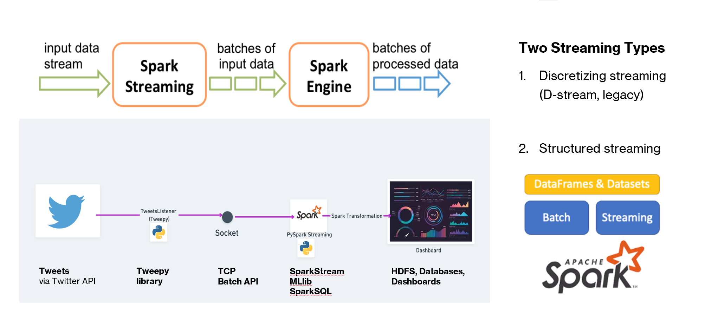
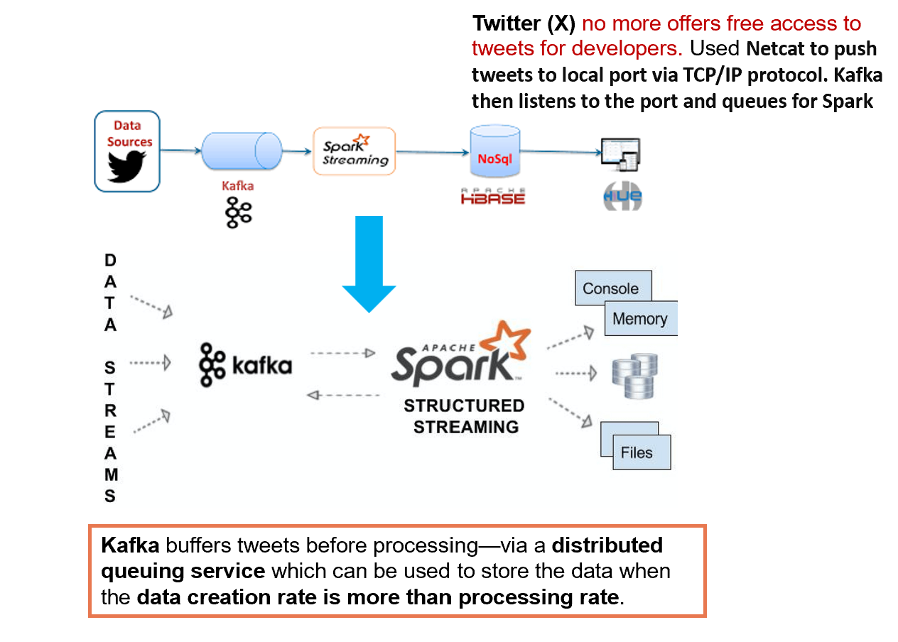
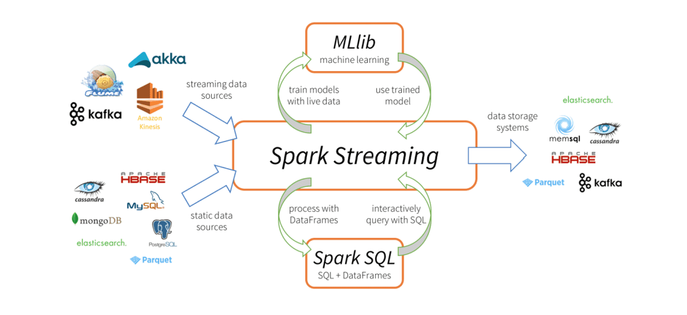
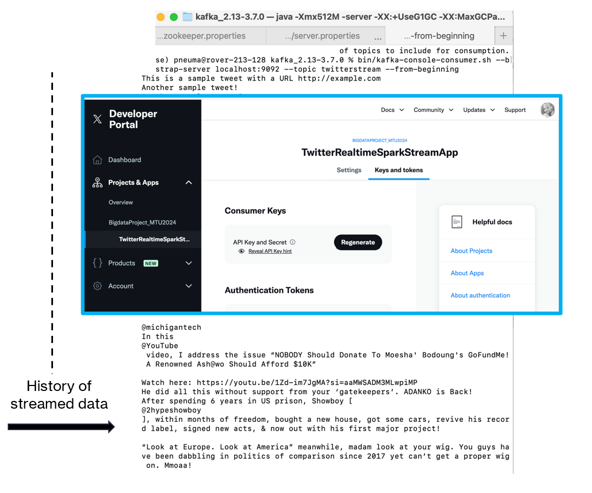
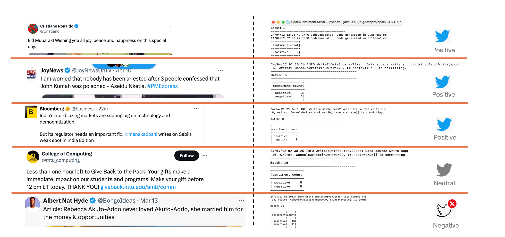

# Real-Time Social Media Streaming and Sentiments Analytics Using Apache Spark


## 1. Project Overview

This project explores real-time social media data streaming and hashtag analytics using Python, TCP sockets, and Apache Spark Structured Streaming.

The work investigates how continuously generated social media conversations can be processed to identify popular hashtags and support timely analysis of online discussions -- positive, negative or neutral.

The implementation combines a Python-based ingestion component, TCP socket communication, and Spark-based stream processing.

In order to bypass direct access to the X (formerly Twitter) Developer API which required paid access, an alternative ingestion approach was implemented: tweet data was fed directly into a manually established TCP port, allowing the listener to receive incoming data without depending on a live API connection.

The project demonstrates an approach to separating data ingestion from stream processing and provides a foundation for further work in real-time analytics, sentiment analysis, and data visualization.

## 2. Research Objectives

The project explores the following objectives:

* Investigate streaming architectures for continuously generated social media data.
* Implement a Python-based component for receiving and transmitting tweet text.
* Develop an alternative data-ingestion approach that does not depend on direct, paid API streaming access.
* Process incoming text using Apache Spark Structured Streaming.
* Extract hashtags and calculate their frequencies.
* Explore applications of real-time analytics for monitoring online conversations and customer responses.
* Investigate opportunities for extending the pipeline to support sentiment analysis and visualization.

## 3. System Architecture

The project connects tweet ingestion with downstream stream processing through a TCP socket.

The original architecture explores social media data collection using Tweepy, TCP communication, and Apache Spark. The alternative ingestion approach allows tweet data to be supplied directly to the local port, independently of live X API access.

### Architecture Diagram



*Figure 1. Streaming architecture illustrating the data-ingestion and processing workflow.*

### Architecture Components

| Component                              | Role                                                                                                    |
| -------------------------------------- | ------------------------------------------------------------------------------------------------------- |
| Tweet data                             | Input data supplied to the streaming workflow                                                           |
| Python                                 | Implements the ingestion and communication logic                                                        |
| Tweepy                                 | Used in the original Twitter/X API integration                                                          |
| TCP socket                             | Transfers incoming text to the processing component                                                     |
| Apache Spark Structured Streaming      | Reads and processes streaming text                                                                      |
| Spark DataFrame operations             | Extracts, normalizes, groups, and counts hashtags                                                       |
| Console output                         | Provides a development output for streaming aggregations                                                |
| Kafka                                  | Handles the queue service for the streaming 
data |
| HDFS, databases, and dashboards        | Discussed in the original presentation as architectural components or potential downstream capabilities |

The supplied implementation uses a local TCP socket for streaming text into Spark. The original presentation also discusses Kafka and downstream storage, but these should not be interpreted as completed integrations unless supported by additional implementation files.

## 4. Methodology

### 4.1 Data Ingestion

The original project explored obtaining tweets through the X Developer API using the Tweepy Python library.

Because the required API access was subject to paid access, an alternative ingestion approach was implemented to continue the experiment without relying on a live API connection.

Tweet data was fed directly into a manually established local TCP port. The Python listener received the incoming data, providing a way to supply tweet text to the downstream streaming workflow.

This approach allowed the project to investigate the stream-processing component independently of direct API access.

### 4.2 TCP-Based Data Transfer

TCP socket communication provides the interface between the incoming tweet data and the processing component.

The supplied Python code uses port [your_local_port], and the Spark notebook configures its socket source to connect to [local_host_server_ip].

This local arrangement supports experimentation with streaming text without requiring a continuously available external data source.



*Figure 2. Kafka Service layout with connected components.*

### 4.3 Stream Processing

Apache Spark Structured Streaming is used to read text from the TCP socket.



*Figure 3. Spark Streaming architecture with connected components.*

User feeds from the X (Twitter) platform are ingested, in this case manually, via the TCP ports. The project used real-time data from online users/feeds at the time of implementation (Mar 2024)



*Figure 4. Queued data flowing through TCP port.*

The supplied notebook defines the following processing operations:

1. Read incoming text from the socket.
2. Split the text into individual words.
3. Filter tokens beginning with the hashtag character (`#`).
4. Convert hashtags to lowercase.
5. Group hashtags by their normalized values.
6. Calculate the occurrence count for each hashtag.
7. Configure the streaming query to display aggregated results in the console.

Lowercase normalization allows hashtags that differ only in capitalization to be grouped together.

For example, `#GreatComment` and `#greatcomment` would be normalized to the same representation.

### 4.4 Aggregation and Output

The Spark processing logic uses DataFrame transformations and aggregation to calculate hashtag frequencies.

The intended output identifies hashtags and their occurrence counts, providing a foundation for examining which topics are appearing most frequently in the supplied stream.

<!-- The supplied notebook also contains an attempted visualization section using Pandas, Matplotlib, and Seaborn. That section requires validation because it references objects not defined in the supplied implementation. -->

## 5. Results and Experimental Observations

The project investigates the use of streaming data processing to analyze social media text and identify hashtag frequencies.

The original academic presentation also includes sentiment-analysis examples categorized as positive, neutral, and negative.

### Results Diagram



*Figure 5. Results showing analysis of live feeds from the stream.*

<!-- The results should be interpreted in the context of the original experiment and the functionality demonstrated by the supplied implementation.

The code defines the hashtag-extraction and aggregation logic. Actual performance figures, processing volumes, and model-evaluation metrics should be reported only when supported by experimental evidence.

The sentiment-analysis examples in the original presentation establish the project's broader analytical direction; the supplied notebooks do not, by themselves, establish a complete, reproducible sentiment-classification pipeline. -->

## 6. Technologies Used

| Technology                 | Application                                                  |
| -------------------------- | ------------------------------------------------------------ |
| Python                     | Ingestion and application logic                              |
| Tweepy                     | Original Twitter/X API integration                           |
| TCP sockets                | Local streaming-data transfer                                |
| Apache Spark               | Data processing                                              |
| Spark Structured Streaming | Stream-processing interface                                  |
| Spark SQL and DataFrames   | Text transformation and hashtag aggregation                  |
| Pandas                     | DataFrame conversion in the attempted visualization workflow |
| Matplotlib                 | Plotting                                                     |
| Seaborn                    | Statistical visualization                                    |

## 7. Repository Structure

```text
real-time-social-media-streaming-analytics/
│
├── README.md
├── paper/
│   └── Report_Paper-TwitterSentimentAnalysisUsingApacheSpark_2024.pdf
├── images/
│   ├── tweet-analytics-architecture.png
│   ├── kafka-streaming-flow.png
│   ├── spark-streaming-flow.png
│   ├── stream-queued-data.png
│   └── sentiments-results.png
├── notebooks/
│   ├── TweetsListener.ipynb
│   └── SparkSessionRun.ipynb
├── src/
│   └── TweetsListener.py
├── docs/
│   └── architecture.md
├── tests/
├── requirements.txt
├── .env.example
├── .gitignore
└── LICENSE
```

The original academic presentation is preserved in the `paper/` directory. The notebooks document the experimental workflow, the Python source contains the listener implementation, and the `images/` directory contains the architecture and results diagrams.

## 8. Setup and Execution

### Prerequisites

The intended development environment includes:

* Python
* Tweepy, if the original API integration is used
* Apache Spark with Structured Streaming support
* PySpark
* A compatible Java runtime for the selected Spark version
* A local TCP socket for transferring streaming text

The original Spark notebook also uses `findspark` to initialize a local Spark installation.

### Step 1: Clone the Repository

```bash
git clone https://github.com/YOUR_USERNAME/real-time-social-media-streaming-analytics.git
cd real-time-social-media-streaming-analytics
```

Replace `YOUR_USERNAME` with your GitHub username.

### Step 2: Set Up the Python Environment

Create a virtual environment:

```bash
python -m venv .venv
```

Activate it on Windows:

```powershell
.venv\Scripts\Activate.ps1
```

Or on macOS/Linux:

```bash
source .venv/bin/activate
```

Install the verified project dependencies:

```bash
pip install -r requirements.txt
```

### Step 3: Configure the Data Source

The project supports an alternative ingestion approach in which tweet data is supplied directly to a local TCP port.

This avoids making the experimental processing workflow dependent on live X Developer API access.

If the original API-based ingestion is used, appropriate developer credentials, permissions, and configuration are required. API credentials must be supplied securely through environment variables or another secrets-management mechanism.

Never commit API tokens or other secrets to the repository.

### Step 4: Run the Streaming Workflow

The intended workflow is to supply tweet text through the TCP interface and process the incoming data with Spark Structured Streaming.

The supplied notebooks document the original implementation. Review and validate the listener, socket configuration, Spark query, and aggregation logic before relying on the repository as a reproducible end-to-end execution environment.

For development and testing, controlled sample text can be used to validate hashtag extraction and aggregation independently of external API access.


## 9. Limitations

The available implementation and presentation these limitations:

* The original implementation was developed as an academic streaming experiment rather than a production deployment.
* The alternative ingestion approach avoids dependence on direct API access but does not, by itself, provide a production-grade data-ingestion service.

These limitations provide a basis for further implementation, testing, and evaluation.

## 10. Research Application and Future Work

For further work, the following will be considered:

* Develop a more robust ingestion, transformation, validation, and persistence pipeline. Combine streams from different sources into a repository, then perform sentiment analysis on the stream data in real time.
* Extend the processing logic to support richer aggregations and event-level analytics. Visualize real-time traffic using dashboards for monitoring hashtag trends, message volumes, and analytical outputs.
* Evaluate Kafka or another messaging system for buffering and distributing incoming events.
* Investigate sentiment classification and other text-analysis techniques, with appropriate model evaluation, measure processing throughput, end-to-end latency, and reliability under controlled workloads.
* Explore cloud-based storage and analytics services for scalable deployment.

## 11. Conclusion

This project explores a streaming analytics workflow for social media text, with a focus on hashtag extraction and frequency analysis using Python and Apache Spark Structured Streaming.

When direct X Developer API access required paid access, an alternative ingestion approach was implemented to supply tweet data through a local TCP port. This allowed the project to investigate the downstream streaming architecture without depending on a live API connection.

The work provides an academic foundation for further exploration of real-time data engineering, stream processing, social media analytics, and machine-learning-enabled analysis.

## 12. Author

**[Samuel Darteh]**(https://linkedin.com/in/sdartehpro)
[LinkedIn](https://linkedin.com/in/sdartehpro)

**Academic Affiliation:** Michigan Technological University 
**Project Type:** Big Data Analytics - Academic Research and Technical Implementation

## 13. Original Academic Presentation

The original project was developed as part of the requirements for Big Data Analytics at [Michigan Technological University](https://mtu.edu).

The presentation documents the research motivation, streaming architecture, methodology, experimental context, sentiment-analysis examples, conclusions, and future-work directions.

**Original presentation:** [`paper/SemProPresent.pdf`](paper/Report_Paper-TwitterSentimentAnalysisUsingApacheSpark_2024.pdf)

 


